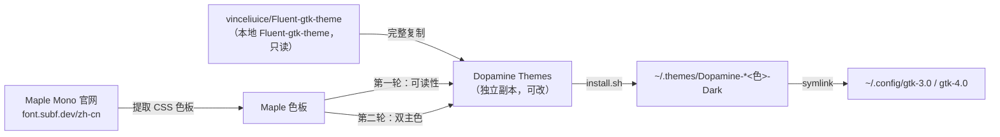
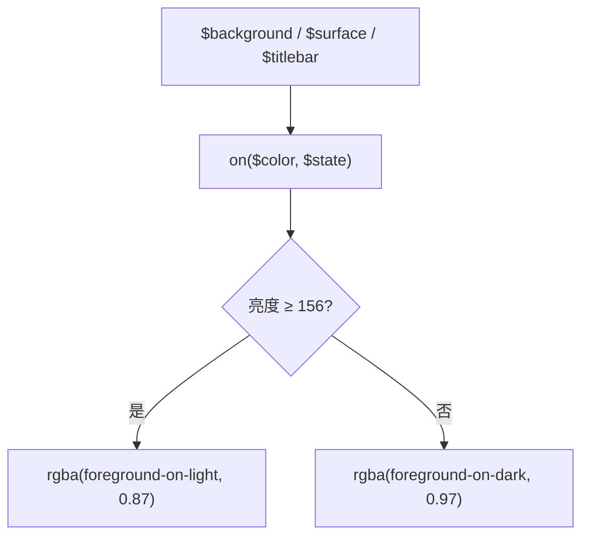

# Dopamine Themes 主题定制手册

本文档记录 `Dopamine Themes` 主题的来源、定制过程与验证方法。
后续要定制其他主题时，按「第 6 节 SOP」执行即可复用整套流程。

---

## 1. 主题从哪来



- **上游**：`/path/to/Fluent-gtk-theme`（你本地的 Fluent-gtk-theme 只读副本），保持 `git status` 干净，**永不修改**。
- **副本**：`Dopamine Themes` 项目根目录（你即将把文件夹重命名为 Dopamine），所有改动都在这里。
- **配色来源**：Maple Mono 官网 CSS（`curl` 页面 → 提取 `/_astro/*.css` → 统计 hex 频率）。

本 fork 的颜色变体：**10 个完整调色板主题**（4 个经典配色 nord/gruvbox/monokai/catppuccin + 6 个暖色配色 candy/tangerine/berry/magenta/sakura/coral，参考终端/编辑器经典配色与暖色方案重新为桌面设计；第七轮删除了 6 个冷色主题，见下文）、
明暗变体、5 个 tweak（solid/float/round/noborder/square；本 fork **不提供** blur 版本）、
GTK 2/3/4、GNOME Shell 3-28~48、Cinnamon、Metacity、xfwm4、labwc、plank、Firefox 资源。

名称迁移点：`install.sh` 的 `THEME_NAME`、`release/make-release.sh`、README、
Firefox chrome、Metacity/xfwm4 元数据。

### 1.1 完整调色板主题（第四轮重构）

旧的 15 个 btop 衍生变体只替换了一个强调色，导致各主题除了 accent 外几乎一样。
第四轮重构把每个主题做成**完整调色板**：背景、表面、基底、正文、次级文字、链接、成功/警告/错误、标题栏/面板全部按主题重新设计。

参考来源包括 btop 主题、Nord/Dracula/Gruvbox/Tokyo Night/Everforest/Monokai/Solarized/Catppuccin 等经典配色，
但为 GTK/GNOME 桌面调整了对比度与可读性，不照搬终端色值。

**第六轮起**，dark 变体统一改为「明亮深色」路线：底色不是灰暗中性色，而是**高彩度、明度 18–37% 的同色相阶梯**
（背景 → 表面 → 内容区 → 次级表面），强调色保留各配色原始色相，仅在对比不足时微调。
上表同时给出 dark / light 的背景与内容区色值，便于对着预览核对。

| 主题 | 个性 | dark 主色 | light 主色 | dark 背景 | dark 内容区 | light 背景 | light 内容区 |
|---|---|---|---|---|---|---|---|
| nord | 冰蓝/北极 | `#88C0D0` | `#5E81AC` | `#183344` | `#314B68` | `#F1F6F9` | `#DDEBF3` |
| gruvbox | 暖金/大地 | `#FABD2F` | `#AF7D1B` | `#442E18` | `#685531` | `#F9F5F1` | `#F3E8DD` |
| monokai | 暖黑/霓虹 | `#F9357C` | `#C46B02` | `#441E18` | `#684131` | `#F9F2F1` | `#F3E0DD` |
| catppuccin | 紫粉/pastel | `#F5C2E7` | `#8839EF` | `#3B1844` | `#653168` | `#F7F1F9` | `#EEDDF3` |
| candy | 糖果粉 | `#FF4F9A` | `#E91E63` | `#441837` | `#68314F` | `#F9F1F7` | `#F3DDEC` |
| tangerine | 活力橙 | `#FF8A1F` | `#CC6700` | `#442918` | `#684F31` | `#F9F4F1` | `#F3E6DD` |
| berry | 酒红/浆果 | `#FF6F91` | `#E91E63` | `#44181F` | `#683132` | `#F9F1F2` | `#F3DDE1` |
| magenta | 品红/霓虹 | `#F047A8` | `#D6008C` | `#3C1026` | `#62283C` | `#F9F1F5` | `#F3DDE8` |
| sakura | 樱花粉 | `#FF9CC2` | `#D6477C` | `#522833` | `#714146` | `#F9F1F3` | `#F3DDE3` |
| coral | 珊瑚 | `#FF7A5C` | `#D94A32` | `#4A2117` | `#6F462F` | `#F9F2F1` | `#F3E2DD` |

完整色板定义在 `src/_sass/_theme-palettes.scss`，GTK 与 GNOME Shell 共用同一份 map。
每个主题不再区分「这是亮系还是暗系」；只保证 light/dark 两种 GNOME 变体都协调、对比足够。

每个变体的资源链（本机无 inkscape/rendersvg，PNG 用**像素色相重映射**生成）：

| 资源 | 来源 | 方法 |
|---|---|---|
| GTK3 `assets-<theme>/`（52 PNG）| `assets/` | HSV 色相旋转（蓝域 → 目标色相），S/V 按主色比例缩放；`-dark` 文件映射到 light 主色 |
| GTK2 `assets-<theme>{,-Dark}/`（30+30 PNG）| `assets{,-Dark}/` | 同上 |
| GTK2 `gtkrc-<theme>{,-Dark}` | `gtkrc{,-Dark}` | sed `#0078D4` |
| Shell `theme-<theme>/`（3 SVG）| `theme/` | sed `#0078D4`/`#1A73E8` |
| `assets-<theme>.svg` 源 | `assets.svg` | sed `#1A73E8`/`#3281EA`（供上游渲染链）|
| thumbnail PNG | `thumbnail*.png` | 色相重映射 |

注意 GTK2 Dark 目录命名是 `assets-<theme>-Dark`（`install.sh` 拼 `assets$theme$ELSE_DARK`），
不要写成 `assets-Dark-<theme>`。

自动化脚本：`scripts/generate-theme-assets.py`，一次生成 **全部配色**的 PNG/SVG/gtkrc/thumbnail。

> 该脚本与 `scripts/gen-previews.py` 都通过 `scripts/palette_utils.py` 直接解析
> `src/_sass/_theme-palettes.scss`，不再各自维护一份硬编码色表。
> 5 个多巴胺主题曾因此漏掉 PNG 重着色：GTK 输入框聚焦环一直是上游的 `#1A73E8` 蓝色，
> 详见 `INVESTIGATION-color-mismatch.md`。

---

## 2. 配色系统

### 2.1 完整调色板（共享 map）

色板集中在 `src/_sass/_theme-palettes.scss`，每个主题提供 light/dark 两组完整颜色：

| 角色 | 说明 |
|---|---|
| `primary` | 选中/开关/进度/suggested 主强调色 |
| `background` | 窗口背景 `$background` |
| `surface` | 卡片/弹出层 `$surface` |
| `base` | 内容区/输入框 `$base` |
| `base-alt` | 次级表面 `$base-alt` |
| `foreground` | 正文色（`on()` 据此推导）|
| `foreground-secondary` | 次级文字 |
| `foreground-on-dark` | 用于深色背景上的动态前景 |
| `foreground-on-light` | 用于浅色背景上的动态前景 |
| `link` / `link-visited` | 链接色 |
| `success` / `warning` / `error` | 语义色 |
| `titlebar` / `panel` | 标题栏与面板底色 |

GTK 通过 `@import 'theme-palettes'` 读取 map，再用 `theme-color('background')`、`theme-color-mode('dark', 'titlebar')` 等函数绑定到 `$background`、`$titlebar` 等变量。
GNOME Shell 的 `_colors.scss` 同样导入该 map，绑定到 `$base_color`、`$fg_color`、`$primary_color` 等 Shell 变量。

### 2.2 动态前景



- GTK：`src/_sass/_colors.scss` 的 `on($color, $state)`。
- Shell：`src/gnome-shell/sass/_colors.scss` 的 `foreground($color)`。
- 亮度公式 `(R*299+G*587+B*114)/1000`，阈值 156。
- `foreground-on-dark` / `foreground-on-light` 来自当前主题调色板，因此暗色主题可以用暖灰正文（如 Gruvbox `#ebdbb2`），亮色主题可以用冷灰正文（如 Nord `#2e3440`）。

### 2.3 default 主题

`default`（未指定 `-t` 时安装）保留为独立调色板：
- dark：`#fbdbb6` 暖桃强调 + `#273749` 蓝灰背景
- light：`#bf7c50` 深桃强调 + `#eef3f8` 冷白背景

它不再退回到某个 btop 变体，确保无 `-t` 时仍有统一且可预测的外观。

---

## 3. 我们做过什么（操作史）

### 第一轮：可读性修复（Nautilus/设置内容区近黑、Shell 选中白字）

1. 深色 `$base` `#1e1e1f` → `#263847`（含 blur 分支 `rgba(#263847, $blur_opacity)`）——
   根因是内容区基底，不是文字色。
2. 正文/标题/禁用等全部走 `on()` 动态前景；Shell 侧 `$fg_color` 等变量换
   `#d9e9f2` / `rgba(#10222d, …)` 系列。
3. Shell 选中态 `color: white` → 动态前景，涉及文件：
   - `widgets/_quick-settings-42/44/48.scss`（checked/hover/active/菜单按钮/header 图标）
   - `widgets/_switches-47.scss`（含 `.handle`）
   - `widgets/_buttons.scss`（`%default_button` 全状态）
   - `widgets/_calendar.scss`、`_calendar-46.scss`（today 全状态）
   - `widgets/_dialogs-47.scss`（destructive/suggested）
   - `widgets/_window-picker.scss`、`_app-grid{,-44,-46}.scss`、`_screenshot.scss`
   - `_common-3-28.scss`（system-menu-action/calendar-today/app-view-control）
4. GTK 微修：`_common-3.20.scss` 红色 OSD 按钮 `on()` 化；
   `_common-4.0.scss` coverflow cover 黑边 `black` → `$border`。
5. **刻意保留**纯白/纯黑的专用高对比元素：`lightbox`、`flashspot`、screen-shield 解锁时钟、
   截图 UI 选择框、GTK `%osd-button`、`.avatar.contrasted`、Shell `$system_bg_color: #1e1e1f`。

### 第二轮：双主色鲜明化（解决「灰败」单色相）

1. 从网页提取 vivid 色，用户选定「桃选中 + 紫进度」组合。
2. 两份 `_colors.scss` 的 `theme()`：default dark `#abd5ed→#fbdbb6`、light `#527cad→#bf7c50`；
   orange dark 错开为 `#f7cf9e` 避免与新 default 撞色。
3. 新增 `$focus`（GTK）/`$focus_color`（Shell），替换引用：
   - GTK：`_common-3.20.scss`（树进度、progressbar、osd progress、levelbar）、
     `_common-4.0.scss`（同上 + editablelabel editing 轮廓 ×2）、`apps/_mate.scss`（OSD 进度）。
   - Shell：`_slider.scss`、`_slider-47.scss`、`_osd.scss`、`_osd-42.scss`、
     `_common-3-28.scss` 的全部 `-barlevel-active-*` 及 OSD 槽底。
4. Cinnamon 共用 `src/_sass/colors`，自动跟随，无需单独改。

### 第四轮：完整调色板重构（废弃 15 个单 accent btop 变体）

1. 废弃旧的 15 个 btop 单强调色变体，重新设计 8 个完整调色板主题：
   nord / dracula / gruvbox / tokyo-night / everforest / monokai / solarized / catppuccin。
2. 新增 `src/_sass/_theme-palettes.scss`：每个主题定义 light/dark 完整色板，
   GTK 与 Shell 共用同一份 map，避免两份 `_colors.scss` 重复维护。
3. 重写 `src/_sass/_colors.scss` 与 `src/gnome-shell/sass/_colors.scss`：
   - 背景、表面、基底、正文、链接、语义色、标题栏、面板全部取自调色板。
   - `on()` / `foreground()` 使用主题自己的 `foreground-on-dark` / `foreground-on-light`。
   - 标题栏/面板在「light 内容 + dark 标题栏」标准变体下使用 dark 调色板。
4. `install.sh`、`release/make-release.sh`、各 `render-assets.sh`、
   `scripts/gen-previews.py` 的主题列表同步更新。
5. 新增 `scripts/generate-theme-assets.py`（8 个经典主题）：
   从上游蓝色资源通过 HSV 色相重映射批量生成 8 主题的 GTK2/3 PNG、GTK2 gtkrc、
   Shell SVG、thumbnail PNG。
6. 新增 `scripts/generate-dopamine-assets.sh`（5 个多巴胺主题）：
   为 candy / tangerine / minty / berry / nebula 生成 SVG/PNG/gtkrc/thumbnail/README 预览图。
   因本机无 `inkscape`/`rendersvg`，GTK PNG 资源先复制默认蓝色资源作为 fallback，
   后续安装 `inkscape` 后可重新渲染主题色资源。
7. default 主题独立为完整调色板，不再 fallback 到 dracula。

### 第五轮：暖化 + 提亮 + 预览去伪（2026-11）

起因：反馈「整体偏冷、偏阴郁」，且 README 里的 berry 明亮、装上却是深紫。
排查过程与数据见 [INVESTIGATION-color-mismatch.md](INVESTIGATION-color-mismatch.md)。

1. **dark 中性层全量提亮**（13 个主题）：`background`/`surface`/`base`/`base-alt`/
   `titlebar`/`panel` 明度 +4~5 个点、彩度 ×0.90，并整体向暖侧偏 3 个 RGB 单位去蓝彩。
   暗色窗口底从 10–22% 提到 15–26%。
2. **5 个多巴胺主题按暖色阶梯重写 dark 中性层**（色相明确转向暖区）：
   - berry `#2A1622 → #331F1E`（色相 324° → 3°）、candy `#2D1B2E → #301C23`（297° → 339°）
   - tangerine / minty / nebula 保持各自色相身份，明度抬到 15–17%
   - berry / candy 的紫罗兰 link 改为暖色（`#B388FF → #FFB48F`、`#6C63FF → #FF9E80`）
3. **light 变体不做色相改造**（本来就亮），只把过暗的窗口底抬到 88%
   （tokyo-night `#d5d6db → #dedfe3`），其余保持原色相。
4. **README 预览改为真实渲染**：`scripts/gen-previews.py` 直接解析色板，生成
   640×360 的窗口 mock（标题栏/侧栏/内容区/选中行/开关/进度条），覆盖 13 个配色 + default；
   删除了 `generate-dopamine-assets.sh` 中用 ImageMagick 画纯色块的占位逻辑
   —— 那正是 README 里 berry「看起来明亮」的来源。
5. **修复多巴胺主题的蓝色聚焦环**：此前 5 个主题的 `entry-focus*.png` 直接复制上游蓝色资源，
   现由 `generate-theme-assets.py` 统一按色板重着色，不再有 `#1A73E8` 残留。
   同源问题一并修掉：多巴胺主题的 GTK2 PNG 之前同样是蓝色；
   `gtkrc-<theme>-Dark` 之前取错成 light 强调色（现在 berry Dark = `#FF6F91`）。

### 第六轮：换一套「明亮深色」配色（2026-11）

第五轮的暖化只提亮降彩，暗色仍然偏灰、偏闷。第六轮直接换设计路线：

- **底色用高彩度同色相阶梯**，而不是灰暗中性色：
  `background / surface / base / base-alt` 明度 18% / 24% / 30% / 37%，饱和 48% / 44% / 36% / 30%。
  深色依然深，但颜色是「浓郁的酒红 / 深紫 / 森绿 / 深海蓝」，不是灰。
- **明度阶梯内色相逐级 +4°/+9°/+13° 偏暖**，内容区比窗口底略暖，形成层次。
- **强调色保留各配色原始色相**，只在对比度不足时自动微调：
  dark 目标 `≥2.4:1`（对内容区）、light 目标 `≥3.0:1`；次级文字对内容区 `≥4.5:1`。
  例：solarized 仍是 `#B58900` 琥珀、monokai 微调为 `#F9357C`、minty light 压到 `#009B86` 以便浅底可读。
- **light 变体改为同色相浅底**（背景 S≈42/L≈96、内容区 S≈46/L≈91），不再是冷白/纯白。
- 新增 `assets/preview/contact-sheet-{dark,light}.png`：`gen-previews.py --contact-sheet`
  把 14 张预览拼成一张审阅图，方便一次看全 13 个配色。
- README 重做：窗口示意图缩略后看不清配色，改为 **SVG 色卡**（`scripts/gen-palette-cards.py`）：
  `overview.svg` 一行一个配色（dark/light 各 4 格），`palettes/<配色>.svg` 列出 8 个角色与色值，
  并画出 `surface · base · accent` 的面积占比；README 按「总览 → 配色卡 → 界面示意 → 安装/构建」重组。

实测对比度（dark，正文/内容区）6.0–10.2，强调/内容区 2.4–7.4，均不低于可读阈值。

### 第七轮：去掉冷色，补三套暖色（2026-11）

反馈：teal / 绿 / 靛这一系冷色与整体暖色审美不符，删掉；同时补品红、粉、珊瑚。

1. **删除 6 个冷色主题**：nebula / minty / solarized / everforest / tokyo-night / dracula。
   同步清理 `_theme-palettes.scss`、`install.sh`（THEME_VARIANTS / `-t` 解析 / help）、
   `release/make-release.sh`、`src/gtk/make-assets.sh`，以及各自的 `assets-*`、`gtkrc-*`、
   `theme-*`、thumbnail、预览与色卡。
2. **`install.sh` 的 `-t` 解析改为按列表校验**（原本用 `THEME_VARIANTS[n]` 下标，删主题必错位）；
   `install_theme_color` 改为整行写入，不再依赖 `sed s/default/…/`。
3. **新增 3 套暖色**，沿用第六轮的「明亮深色」阶梯，但用明度/饱和把彼此拉开：

| 配色 | 参考色 | dark 背景 | dark 内容区 | dark 强调 | light 强调 | 个性 |
|---|---|---|---|---|---|---|
| magenta（品红） | Rosé Pine `love #EB6F92`、Catppuccin `pink #F5C2E7` | `#3C1026` | `#62283C` | `#F047A8` | `#D6008C` | 最暗最艳（L15/S58），霓虹品红 |
| sakura（樱花粉） | Kanagawa `sakuraPink #D27E99`、Catppuccin `rosewater #F5E0DC` | `#522833` | `#714146` | `#FF9CC2` | `#D6477C` | 最浅最柔（L24/S34），奶油樱花 |
| coral（珊瑚） | Kanagawa `peachRed #FF5D62`、Sweet Twilight `#D46A3B` | `#4A2117` | `#6F462F` | `#FF7A5C` | `#D94A32` | 居中（L19/S52），陶土珊瑚 |

   与已有的 candy（玫紫 318°）、berry（酒红 350°）、tangerine（橙 24°）、monokai（暖黑红 8°）、
   gruvbox（褐金 30°）在色相与明度上都能区分。

参考来源：
- Rosé Pine palette：<https://rosepinetheme.com/palette>
- Kanagawa：<https://github.com/rebelot/kanagawa.nvim>
- Catppuccin：<https://github.com/catppuccin/catppuccin>
- ColorDrop "Sweet Twilight"：<https://colordrop.io/palette/35154>

### 工具链修复

- **`install.sh --name` 无效 bug**：原代码 `-n|--name` 分支写的是 `_name="$2"`，
  而安装循环用 `${name:-$THEME_NAME}`，`name` 从未赋值 → tweak 版会**同名覆盖**普通版。
  已修为 `name="$2"`。
- 安装命名策略：普通版 `--name Dopamine`，所有 tweak 版都用各自独立的 `--name` 区分。

---

## 4. 目录/文件地图

| 路径 | 作用 |
|---|---|
| `src/_sass/_colors.scss` | GTK/Cinnamon 配色：`on()`、`theme()`、`$primary/$focus`、语义色 |
| `src/gnome-shell/sass/_colors.scss` | Shell 配色：`foreground()`、`theme()`、`$focus_color` |
| `src/_sass/gtk/_common-{3.20,4.0}.scss` | GTK 控件样式（进度/levelbar/OSD） |
| `src/gnome-shell/sass/widgets/_quick-settings-*.scss` 等 | Shell 各版本控件，**必须按版本分层改**，不能合并 |
| `parse-sass.sh` | 全量编译（GTK3/4、Shell 各版本、Cinnamon） |
| `scripts/palette_utils.py` | 解析 `_theme-palettes.scss` 的公共模块（预览/资源脚本共用） |
| `scripts/gen-previews.py` | 生成 `assets/preview/*.png`（全部配色 + default，真实窗口 mock）与 contact-sheet |
| `scripts/gen-palette-cards.py` | 生成 README 用 SVG 色卡：`overview.svg` + `palettes/<配色>.svg` |
| `scripts/generate-theme-assets.py` | 按色板重着色全部 PNG/SVG/gtkrc/thumbnail |
| `install.sh` | 安装/卸载/tweak/变体选择 |
| `release/make-release.sh` | 打包发布 |

---

## 5. 常用命令速查

```bash
cd /path/to/Dopamine-themes

# 1. 改完 scss 后必须重建
./parse-sass.sh

# 1b. 改完配色后重生成资源与 README 图（全部从色板读取）
python3 scripts/generate-theme-assets.py
python3 scripts/gen-previews.py --contact-sheet
python3 scripts/gen-palette-cards.py

# 1c. 或者一条命令跑完整条链（与 CI/README 一致）
./build.sh

# 2. 安装全 13 色（深色）
./install.sh --dest ~/.themes --name Dopamine \
  --theme all --color dark

# 3. 切换 GTK 主题（libadwaita 应用读 ~/.config/gtk-4.0/gtk.css）
#    每个主题目录都自带 gtk-set.sh，会自动清理旧链接并建立新链接
~/.themes/Dopamine-nord-Dark/gtk-set.sh

# 5. 验证生成 CSS 中的颜色（nord 主题预期出现 #88c0d0）
grep -m3 -E '#88c0d0' ~/.themes/Dopamine-nord-Dark/gtk-4.0/gtk-dark.css
```

---

## 6. 新主题定制 SOP

1. **复制副本**：`cp -r Fluent-gtk-theme <NewTheme>`，只改副本；上游保持干净。
2. **名称迁移**：全局替换 `install.sh` 的 `THEME_NAME`、`release/make-release.sh`、
   README、Firefox/Metacity 元数据中的 `Fluent` → 新名。
3. **定色板**：从设计参考提取 10–14 个颜色，
   区分：背景系（3–4 档）、正文两枚（深/浅）、前景-on-dark/on-light 两枚、主强调 1 枚、链接/已访问链接 2 枚、语义 3 枚（红绿黄）、标题栏/面板。
4. **改 `src/_sass/_theme-palettes.scss`**：
   - 为主题新增 light/dark 两个 map。
   - 同步更新 `install.sh`、`release/make-release.sh`、各 `render-assets.sh`、
     文档中的主题列表（`gen-previews.py` / `generate-theme-assets.py`
     已改为解析色板，新增配色只需改 `_theme-palettes.scss` 与本文件）。
5. **改两份 `_colors.scss`**（GTK + Shell 各一份）：
   - 使用 `theme-color()` / `theme-color-mode()` 绑定变量。
   - 正文仍走 `on()`/`foreground()` 动态前景，阈值 156。
   - 标题栏/面板处理「light 内容 + dark 标题栏」标准变体。
6. **控件层按需替换**前景引用（`color: white` → 动态前景）。
   Shell 文件**按版本分层**（-42/-44/-46/-47/-48、_common-3-28），逐一修改。
7. **生成资源**：`python3 scripts/generate-theme-assets.py`。
8. **保留专用高对比**：遮罩、flashspot、截图框、OSD、avatar.contrasted、`system_bg_color`。
9. `./parse-sass.sh` 重建。
10. 安装：tweak 版**用各自独立的 `--name`**。
11. **验证清单**：
    - [ ] `parse-sass.sh` 退出成功，关键 CSS 非空；
    - [ ] grep 生成 CSS：选中色、进度色、动态前景（如 `rgba(16, 34, 45, …)`）均出现；
    - [ ] `~/.config/gtk-{3,4}.0` 链接指向预期目录且 `test -e` 通过；
    - [ ] `git -C Fluent-gtk-theme status --short` 无输出；
    - [ ] Wayland 下无法用 X11 工具截屏时，视觉确认需注销重登后人工查看，
      不要凭 CSS 断言「已生效」。
12. 桌面验证：重启 GTK 应用；Shell 主题需注销重登（Wayland 不能 `Alt+F2 r`）。

---

## 7. 已知坑

| 坑 | 处理 |
|---|---|
| `install.sh` 原 `--name` 写入 `_name` 无效 | 已修复为 `name`；tweak 版必须独立命名 |
| Metacity 3 XML `version="< 3.1"` 解析告警 | 上游固有，与配色无关，忽略 |
| `~/.themes` 下同名目录重装即覆盖 | 切换主题组合时用不同 `--name` |
| GNOME 设置用 libadwaita：改 GTK4 链接后才生效 | 见第 5 节命令 4 |
| Wayland 无法 `import -window root` 截屏 | 视觉验证靠注销重登人工确认 |

---

## 8. 当前状态与交接（2026-11-18）

**配色集合**：10 套（4 经典 nord/gruvbox/monokai/catppuccin + 6 暖色 candy/tangerine/berry/magenta/sakura/coral）+ 兜底 `default`。
冷色系 nebula/minty/solarized/everforest/tokyo-night/dracula 已在第七轮移除。

**产物链路**（改完配色只需一条）：

```bash
./build.sh        # CSS → 资源重着色 → 预览 PNG → README 色卡 SVG
./install.sh -t all
```

**下次接手前要处理的事**：

1. **重装**：`~/.themes` 里现在仍是旧色板；且残留 6 个已删除主题的目录
   （`Dopamine-dracula-*`、`Dopamine-nebula-*` 等），`./install.sh -u -t all` 只清当前名单，
   旧目录需要手动 `rm -rf ~/.themes/Dopamine-{dracula,nebula,minty,solarized,everforest,tokyo-night}-*`。
2. **桌面状态不一致**（2026-11-18 实测）：
   - `gtk-theme` = `Dopamine-tangerine-Dark`（不是刚装的配色）
   - `accent-color` = `teal`，GNOME 47+ 的 libadwaita 应用会用它覆盖主题 accent
   - `~/.config/gtk-4.0/settings.ini` 指向已不存在的 `Fluent-purple-Dark-compact`
   建议统一：设 `gtk-theme` 到目标配色、`accent-color` 改暖色（如 `pink`）、重跑该主题的 `gtk-set.sh`。
3. **版本控制**：本轮改动约 1900 个文件（大部分是重着色 PNG），尚未提交；
   会话期间索引被外部工具自动暂存过（`git status` 出现 `A`/`M` 混合），需要时 `git reset` 后重新 `git add`。
4. **想恢复已删除的配色**：从 `git show HEAD:src/_sass/_theme-palettes.scss` 取回对应 map，
   同时把名字加回 `install.sh` 的 `THEME_VARIANTS`、`release/make-release.sh` 的 `_THEME_VARIANTS`，再 `./build.sh`。
5. **再调色**：只改 `src/_sass/_theme-palettes.scss`，阶梯规则见第 6 节（第六轮）；工具会自动跟随，不会出现硬编码漂移。

**本轮新增/重写的脚本**：

| 脚本 | 作用 |
|---|---|
| `scripts/palette_utils.py` | 解析 `_theme-palettes.scss`，所有工具的唯一数据源 |
| `scripts/gen-previews.py` | 窗口示意 PNG + `--contact-sheet` 总览 |
| `scripts/gen-palette-cards.py` | README 用 SVG 色卡（`overview.svg` + `palettes/*.svg`） |
| `scripts/generate-theme-assets.py` | 按色板重着色全部资源（聚焦环、GTK2 PNG/gtkrc、Shell SVG、thumbnail），取代原先按主题硬编码的脚本 |
| `src/gtk/make-assets.sh`、两处 `render-assets.sh` | 已改为调用上述生成器的兼容 shim |
