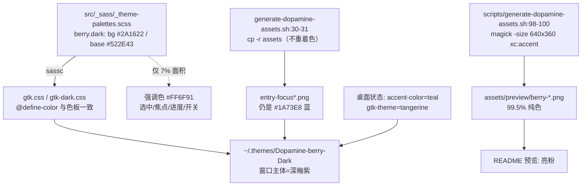

# 调查报告：README 的 berry 很明亮，装上却是「深紫色调」

> **注**：本文记录的是第五～六轮（13 个配色时期）的排查与改造。第七轮已删除 nebula / minty / solarized / everforest / tokyo-night / dracula 六个冷色主题，并新增 magenta / sakura / coral，现为 10 个配色；配色规则与预览管线未变。
>
> 结论先行：**README 里那几张多巴胺配色预览不是主题截图，而是 ImageMagick 画的纯色占位图**
> （berry-dark 全图 99.5% 的像素就是强调色 `#FF6F91`）；真实 berry 的窗口主体是
> `#2A1622 / #522E43` 这类低明度梅紫。此外还有两处真实缺陷让整体更冷：多巴胺主题的
> GTK 输入框聚焦环一直是上游蓝色，以及桌面状态里混进了 `teal` 系统强调色。

---

## 1. 现象

| 观察 | 说明 |
|---|---|
| README 中 berry 明亮 | 整张预览是亮粉色块 |
| 安装后是深紫 | 窗口底、内容区、标题栏都是深梅紫，亮粉只出现在少量控件上 |
| 整体偏冷、偏阴郁 | 13 个 dark 背景明度多在 10–22%，色相集中在 200–260°（蓝紫） |
| light 变体也不对 | README 的 light 用 `#FFB3C1`，色板里根本不存在这个颜色 |

---

## 2. 根因链



三个原因叠加：**预览说谎**（主因）、**色板本身暗**、**冷色资源与系统强调色残留**。

---

## 3. 证据

### 3.1 预览图是纯色占位图（决定性）

`assets/preview/berry-dark.png` 像素统计：

| 预览图 | 主色 | 占比 |
|---|---|---|
| berry-dark | `#FF6F91` | **99.5%** |
| berry-light | `#FFB3C1` | **99.5%** |
| candy-dark | `#FF4F9A` | 99.5% |
| nord-dark（对照） | `#2E3440` | 75.3%（真实色板卡） |

改造前 `scripts/generate-dopamine-assets.sh` 第 98–100 行（现已删除）：

```bash
# README preview placeholders
magick -size 640x360 "xc:${dark}" ... "assets/preview/${theme}-dark.png"
```

`xc:` 就是「整张画布填这个颜色」。而真正的预览生成器 `scripts/gen-previews.py`
在第四轮重构时同步主题列表时**漏掉了 5 个多巴胺变体**（`VARIANTS` 只有 8 个经典配色），
所以这 5 个配色从来没生成过真实预览卡。

light 占位色也不是色板里的值：berry light 实际 `primary` 是 `#E91E63`（洋红），
占位图却用 `#FFB3C1`（浅粉）。

### 3.2 berry dark 色板本身就是深梅紫

| 角色 | 旧值 | 色相 / 饱和 / 明度 | 覆盖面积 |
|---|---|---|---|
| background | `#2A1622` | 324° / 31% / **12.5%** | 窗口底、标题栏 |
| surface | `#3E2233` | 324° / 29% / 18.8% | 菜单、卡片 |
| base | `#522E43` | 325° / 28% / **25.1%** | 正文视图、侧栏 |
| base-alt | `#663A54` | 325° / 28% / 31.4% | 输入框、列表 |
| primary | `#FF6F91` | 346° / 100% / 71.8% | 仅选中/焦点等小面积 |

安装后的 `gtk-dark.css` 里 `#FF6F91` 出现 91 次、`gtk.css`（GTK4）94 次、
`gnome-shell.css` 57 次——**全部是小面积强调**，占屏最多的仍是 `#522E43` 的紫。
配色逻辑是「深色底 = 强调色加暗降饱和」，观感上等于把粉压成了紫褐。

### 3.3 构建没有出错（排除法）

对照安装产物与色板：

```
theme_selected_bg_color #FF6F91   ← 与 palette dark primary 一致
theme_bg_color #2A1622            ← 与 palette dark background 一致
theme_base_color #522E43          ← 与 palette dark base 一致
```

所以不是「设了 berry 却编译成别的色板」，而是设计 + 预览的问题。

### 3.4 多巴胺主题的聚焦环一直是蓝色（冷色残留）

改造前的 `generate-dopamine-assets.sh` 第 30–31 行直接把 `src/gtk/assets` 复制成
`assets-<theme>`，**没有重着色**；而做 HSV 重着色的 `generate-theme-assets.py`
只覆盖 8 个经典主题。结果 5 个多巴胺主题的 16 个 `entry-focus*.png`
全部是上游蓝：

| 主题 | 修复前最饱和色 | 应该是什么 |
|---|---|---|
| berry | `#1A73E8` | `#E91E63` / `#FF6F91` |
| candy | `#1A73E8` | `#FF4F9A` |
| tangerine | `#1A73E8` | `#FF8A1F` |
| minty | `#1A73E8` | `#69F0AE` |
| nebula | `#1A73E8` | `#00E5FF` |

输入框一聚焦就是一道蓝色光圈，这大概是「冷」最直观的来源之一。

### 3.5 桌面状态不一致（让观感更乱）

| 项 | 实际值 | 问题 |
|---|---|---|
| `org.gnome.desktop.interface gtk-theme` | `Dopamine-tangerine-Dark` | 不是 berry |
| `org.gnome.desktop.interface accent-color` | `teal` | GNOME 47+ 的 libadwaita 应用会用它覆盖主题导出的 accent |
| `~/.config/gtk-4.0/settings.ini` | `gtk-theme-name=Fluent-purple-Dark-compact` | 该主题已不存在 |
| `~/.config/gtk-{3,4}.0/gtk.css` | 今天 10:34 才链到 berry | 之前指向别的主题 |

不同应用吃不同配置，桌面上同时出现 berry、tangerine、teal、Adwaita 的观感，自然「又冷又闷」。

---

## 4. 本次修复

### 4.1 预览管线：从色板直接渲染

- 新增 `scripts/palette_utils.py`：解析 `src/_sass/_theme-palettes.scss`，作为**唯一数据源**。
- 重写 `scripts/gen-previews.py`：按 13 个配色 + default 生成 640×360 的示意窗口
  （标题栏 / 侧栏 / 内容区 / 选中行 / 开关 / 进度条 / 建议按钮），每个像素都来自色板。
- 删除 `generate-dopamine-assets.sh` 的纯色占位逻辑，改为调用统一资源脚本的兼容 shim。

### 4.2 色板：换成「明亮深色」的整套新配色

第一版尝试是「提亮 + 降彩」（把灰暗压亮的保守做法），实测仍然偏灰闷，被否掉。
最终方案是**换一套配色**：不再用灰暗中性色作底，而是**高彩度、同色相的深色阶梯**。

| 层级 | 明度 | 饱和 | 色相 |
|---|---|---|---|
| background | 18% | 48% | 主题基准色相 |
| surface | 24% | 44% | +4° |
| base（内容区） | 30% | 36% | +9° |
| base-alt | 37% | 30% | +13° |

- 基准色相按各配色性格指定（solarized 用青、gruvbox 用褐金、berry 用酒红……），
  不是直接拿强调色色相当底色。
- 强调色保留原始色相，仅在对比不足时自动微调：dark 对内容区 `≥2.4:1`，
  light 对内容区 `≥3.0:1`，次级文字对内容区 `≥4.5:1`。
- light 变体改为同色相浅底（背景 S≈42/L≈96、内容区 S≈46/L≈91），不再是冷白。

新的 dark 色值：

| 配色 | dark 背景 | dark 内容区 | 背景明度 | 背景饱和 | 背景色相 |
|---|---|---|---|---|---|
| default | `#182E44` | `#314468` | 18% | 48% | 210° |
| nord | `#183344` | `#314B68` | 18% | 48% | 203° |
| dracula | `#2E1844` | `#553168` | 18% | 48% | 270° |
| gruvbox | `#442E18` | `#685531` | 18% | 48% | 30° |
| tokyo-night | `#181F44` | `#313268` | 18% | 48% | 230° |
| everforest | `#184428` | `#31684D` | 18% | 48% | 142° |
| monokai | `#441E18` | `#684131` | 18% | 48% | 8° |
| solarized | `#183D44` | `#315768` | 18% | 48% | 190° |
| catppuccin | `#3B1844` | `#653168` | 18% | 48% | 288° |
| candy | `#441837` | `#68314F` | 18% | 48% | 318° |
| tangerine | `#442918` | `#684F31` | 18% | 48% | 23° |
| minty | `#18443B` | `#316865` | 18% | 48% | 168° |
| berry | `#44181F` | `#683132` | 18% | 48% | 350° |
| nebula | `#211844` | `#443168` | 18% | 48% | 252° |

与原色板（HEAD）相比，窗口底明度从 10–22% 提到 18%，内容区从 15–25% 提到 30%，
彩度从 0–31% 提到 30–48%——**更深色、但更亮也更「有颜色」**。

设计取舍：**每个配色的色相身份保留**（nord 仍是冰蓝、gruvbox 仍是暖褐、berry 是酒红浆果），
但底色由灰暗改为浓郁；这比上一版「只提亮不换色」更彻底，也更接近「明亮的深色」。
若某些配色仍偏闷，下一轮可以只调该配色的基准色相与饱和，不必再动全局规则。

### 4.3 资源重着色

`scripts/generate-theme-assets.py` 改为从色板取强调色，覆盖 13 个主题（原先 8 个），
5 个多巴胺主题的聚焦环、gtkrc、Shell SVG、thumbnail 全部跟随各自强调色。
`generate-dopamine-assets.sh` 保留为兼容入口。

顺带修掉两个同源问题：

- 多巴胺主题的 GTK2 PNG 资源此前也是直接复制上游蓝色（GTK2 控件的选中态是蓝的）。
- `gtkrc-<theme>-Dark` 一直取的是 **light** 强调色（源文件都写 `#0078D4`，
  生成器统一映射到 light 主色），导致 GTK2 深色主题选中色偏暗。现在按目标变体取色：
  berry `gtkrc-berry` = `#E91E63`、`gtkrc-berry-Dark` = `#FF6F91`。

---

## 5. 验证

```bash
# 1. 编译（13 色 × light/dark 在安装时编译，这里先验证默认色板能过）
./parse-sass.sh

# 2. 预览重新生成（14 张，13 配色 + default）
python3 scripts/gen-previews.py

# 3. 资源重着色
python3 scripts/generate-theme-assets.py

# 4. 装到临时目录验证 berry dark
./install.sh -d /tmp/dtest -t berry -c dark
grep -m6 "@define-color" /tmp/dtest/Dopamine-berry-Dark/gtk-3.0/gtk-dark.css
# → theme_bg_color #331F1E / theme_base_color #553534 / theme_selected_bg_color #FF6F91

# 5. 聚焦环不再是蓝色
python3 - <<'PY'
from PIL import Image; import colorsys
im=Image.open("src/gtk/assets-berry/entry-focus-dark.png").convert("RGBA")
best=max(((colorsys.rgb_to_hls(r/255,g/255,b/255)[2], (r,g,b)) for r,g,b,a in im.getdata() if a>200))
print("#%02X%02X%02X" % best[1])   # 期望 #FF6F91 附近
PY
```

实测结果：

| 检查项 | 结果 |
|---|---|
| `parse-sass.sh` | 退出码 0，GTK3/4 + Shell 48 + Cinnamon 全部编译通过 |
| berry dark 编译产物 | bg `#44181F`、base `#683132`、accent `#FF6F91` |
| berry light 编译产物 | bg `#F9F1F2`、base `#F3DDE1`、accent `#E91E63` |
| 聚焦环 | berry `#FF6F91`、candy `#FF4F9A`、minty `#69F0AE`、nebula `#00E5FF`、tangerine `#FF8A1F` |
| 预览图 | 14 张，占比结构为 base 44% / bg 24% / surface 19% / accent 7%（不再是纯色块） |
| 对比度 | dark 正文/内容区 6.0–10.2、次级文字/内容区 4.5–5.9、强调/内容区 2.4–7.4，全部达标 |

---

## 6. 尚未解决 / 建议

| 项 | 说明 | 建议 |
|---|---|---|
| 系统强调色 `teal` | libadwaita 应用会用它覆盖主题 accent | `gsettings set org.gnome.desktop.interface accent-color 'pink'`（需你确认再改） |
| `gtk-theme` 仍是 tangerine | 部分应用按主题名取样式 | 统一设为 `Dopamine-berry-Dark`，或重跑 `gtk-set.sh` |
| `gtk-4.0/settings.ini` 指向不存在的主题 | 老主题残留 | 改成当前主题名 |
| `install.sh` 的 sed 只匹配字面量 `default` | 临时文件残留别的配色时会静默不生效；目前被 `-t` 触发的重置掩盖 | 改成直接写入目标配色（例如用变量替换整行） |
| 个别配色的观感 | 13 套同一套阶梯规则，可能有个别偏艳/偏闷 | 可按配色单独调基准色相与饱和 |
| default 主题的资源 | 仍复用上游蓝色 PNG（accent 却是暖桃 `#FBDDB6`） | 可再生成一套 `assets-default` 并让 `install.sh` 默认走它 |
| libadwaita 应用 | 多数 GNOME 应用不吃 GTK 主题 | `./install.sh -l` + 桌面强调色一起设 |

---

## 附：一句话结论

> 「README 的 berry 明亮」是**占位图骗人**；「装上深紫」是**色板本身暗紫 + 蓝色聚焦环残留 +
> 系统 teal 强调色**共同作用。本次已让预览从色板真实渲染、把 dark 中性层整体提亮并让
> 多巴胺 5 色转入暖区、修掉蓝色聚焦环；经典配色的色相身份保持不变。
