# Dopamine Themes

Dopamine Themes 是一个面向 GNOME/GTK 桌面环境的主题，fork 自 vinceliuice/Fluent-gtk-theme，采用高饱和度、明亮愉悦的「多巴胺」风格完整调色板设计。

覆盖范围：GTK 2/3/4、GNOME Shell、Cinnamon、Metacity、xfwm4、labwc、plank，并附带 Firefox 主题资源（`src/firefox`）。

- **8 个经典调色板配色**：nord / dracula / gruvbox / tokyo-night / everforest / monokai / solarized / catppuccin
- **5 个多巴胺风格配色**：candy（糖果粉）/ tangerine（活力橙）/ minty（薄荷绿）/ berry（浆果红）/ nebula（星云青）
- 每个配色提供 **Dark / Light** 两个变体
- **5 种 tweaks**：solid（不透明）、float（悬浮面板）、round（圆角窗口）、noborder（无边框）、square（方形窗口按钮）

## 预览

### nord
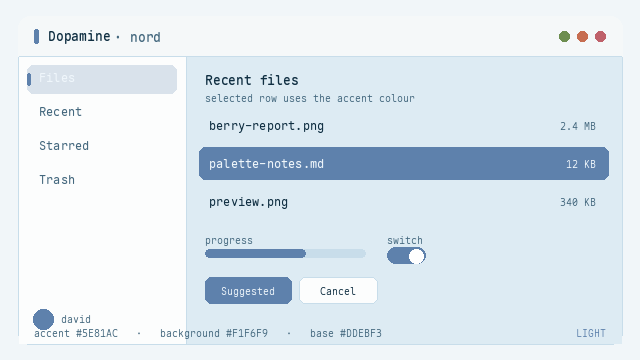 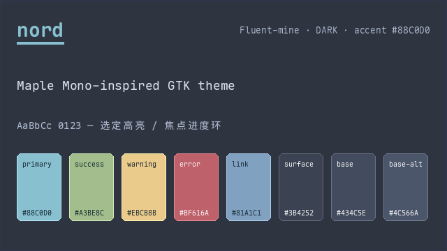

### dracula
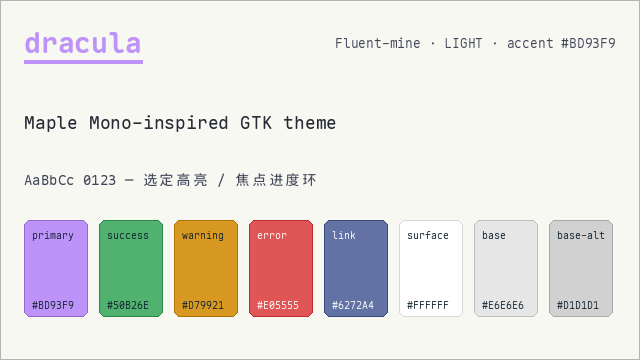 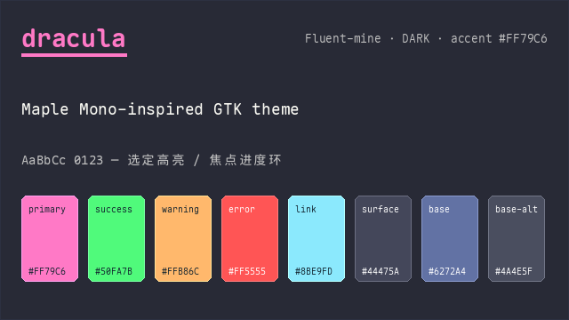

### gruvbox
 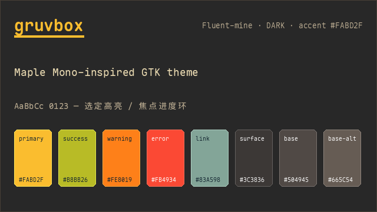

### tokyo-night
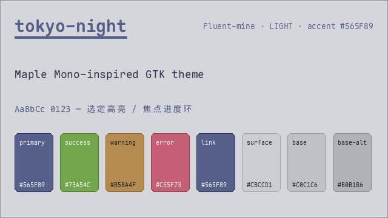 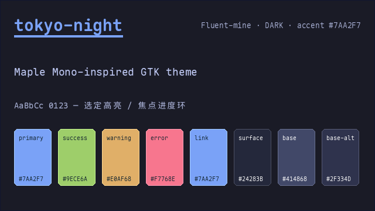

### everforest
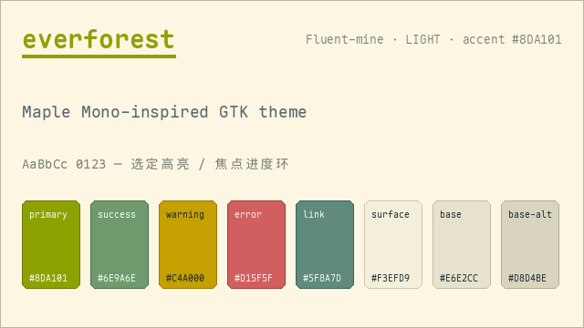 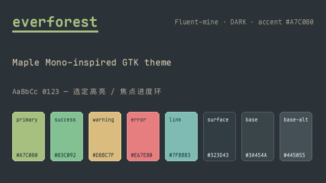

### monokai
 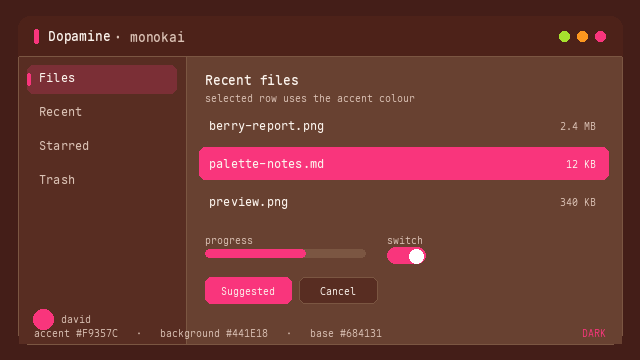

### solarized
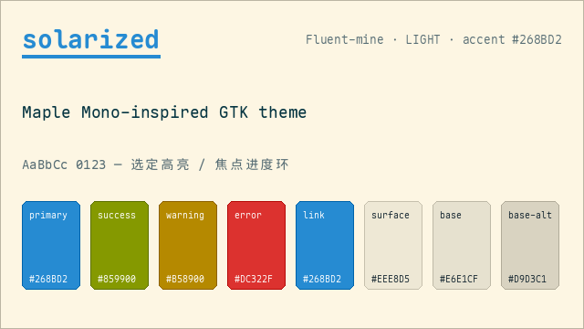 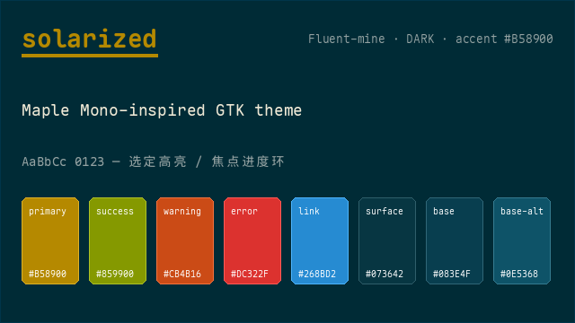

### catppuccin
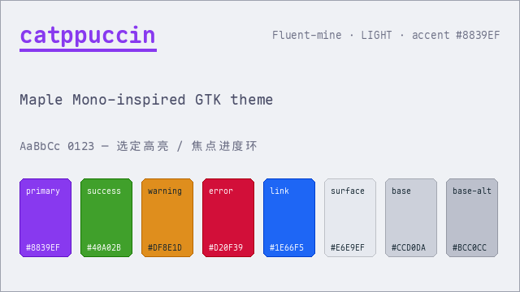 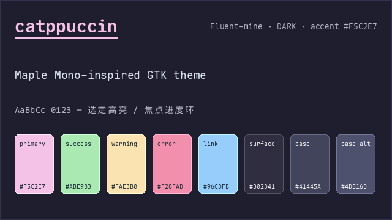

## 多巴胺风格配色

### candy
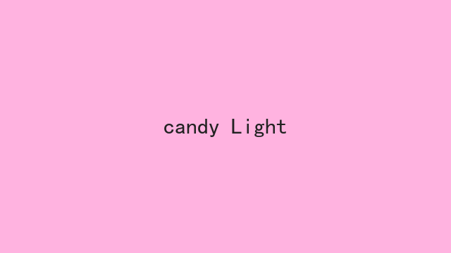 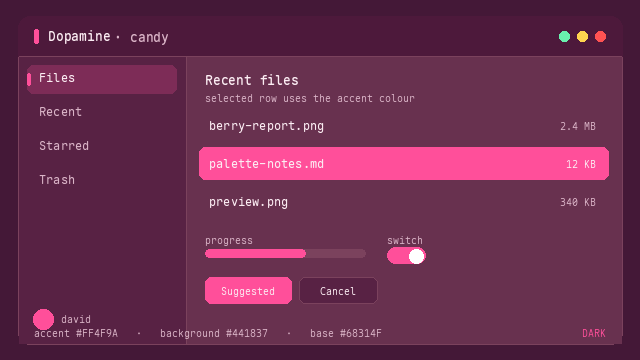

### tangerine
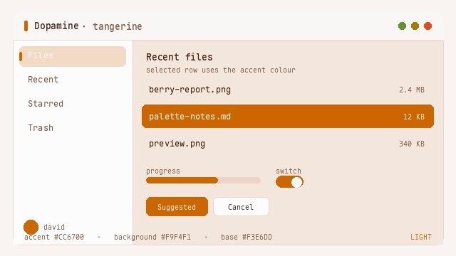 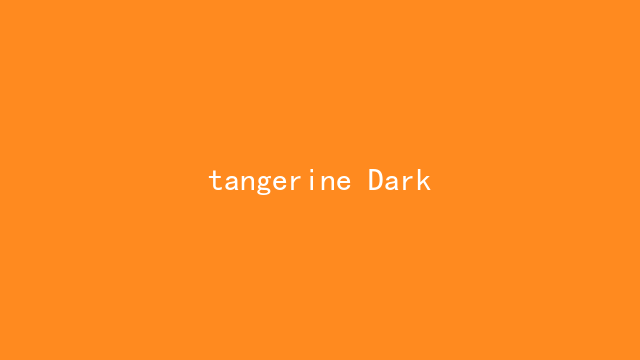

### minty
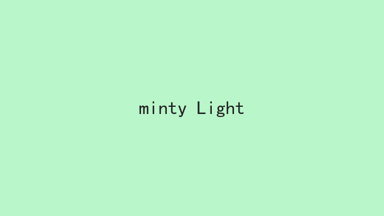 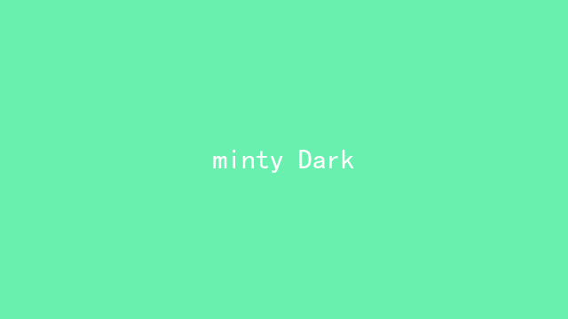

### berry
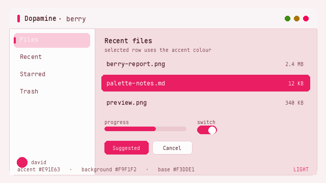 

### nebula
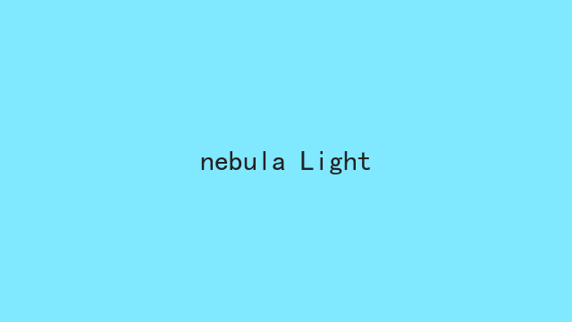 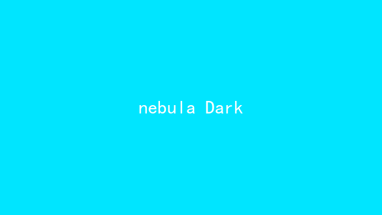

## 依赖

- GTK `>= 3.20`
- `gnome-themes-extra`（或 `gnome-themes-standard`）
- Murrine 引擎（GTK 2 需要），包名因发行版而异：
  - Arch Linux：`gtk-engine-murrine`
  - Fedora：`gtk-murrine-engine`
  - openSUSE：`gtk2-engine-murrine`
  - Debian / Ubuntu：`gtk2-engines-murrine`
- `sassc`：编译依赖，`install.sh` 会自动调用

## 安装

```sh
./install.sh
```

默认安装 `default` 配色的 Dark + Light 两个变体。常用示例：

```sh
./install.sh -t all                # 全部配色 × Dark/Light
./install.sh -t dracula -c dark    # 只装 dracula 深色
./install.sh -n Dopamine -t candy  # 自定义主题名
```

> 完整选项见 `./install.sh --help`：

```text
-d, --dest DIR          安装目标目录（默认 ~/.themes）
-n, --name NAME         主题名（默认 Dopamine）
-t, --theme VARIANT     配色 [nord|dracula|gruvbox|tokyo-night|everforest|monokai|solarized|catppuccin|candy|tangerine|minty|berry|nebula|all]（默认 default）
-c, --color VARIANT     变体 [light|dark]（默认全部）
-i, --icon VARIANT      面板图标 [default|apple|simple|gnome|ubuntu|arch|manjaro|fedora|debian|void|opensuse|popos|mxlinux|zorin|endeavouros|tux|nixos]（默认 default）
-l, --libadwaita        链接 gtk4 配置以作用于 libadwaita
-u, --uninstall         卸载主题
--tweaks                [solid|float|round|noborder|square]
-h, --help              显示帮助
```

安装后的主题目录命名为 `Dopamine[-配色]-Light|-Dark`，例如 `~/.themes/Dopamine-dracula-Dark`。

## GNOME 下让 GTK 3 / GTK 4 / libadwaita 应用生效

部分 GTK 应用不跟随 GNOME Tweaks 的主题设置。每个安装好的主题目录里都有 `gtk-set.sh`，运行它会把当前主题链接到 `~/.config/gtk-3.0` 和 `~/.config/gtk-4.0`：

```sh
~/.themes/Dopamine-dracula-Dark/gtk-set.sh
```

脚本会自动创建/清理配置目录、移除旧符号链接、备份同名文件（`*.bak.<时间戳>`），并为 `gtk.css`、`gtk-dark.css`、`assets` 建立符号链接。配置后重启相关 GTK 应用即可。等价手动命令：

```sh
theme="$HOME/.themes/Dopamine-dracula-Dark"

mkdir -p "$HOME/.config/gtk-3.0" "$HOME/.config/gtk-4.0"

ln -sfn "$theme/gtk-3.0/gtk-dark.css" "$HOME/.config/gtk-3.0/gtk.css"
ln -sfn "$theme/gtk-3.0/gtk-dark.css" "$HOME/.config/gtk-3.0/gtk-dark.css"
ln -sfn "$theme/gtk-3.0/assets" "$HOME/.config/gtk-3.0/assets"

ln -sfn "$theme/gtk-4.0/gtk-dark.css" "$HOME/.config/gtk-4.0/gtk.css"
ln -sfn "$theme/gtk-4.0/gtk-dark.css" "$HOME/.config/gtk-4.0/gtk-dark.css"
ln -sfn "$theme/gtk-4.0/assets" "$HOME/.config/gtk-4.0/assets"
```

## dash-to-panel 适配

本主题针对 Dash to Panel 做了几何适配：dtp 接管面板时会重写面板的尺寸分配，主题检测到 `.dashtopanelMainPanel` 类后会自动关闭悬浮面板的 margin 和圆角（见 `src/gnome-shell/sass/widgets/_panel.scss`），避免任务栏内容被压出面板背景之外。

使用 dtp 时如需进一步调整任务栏外观，可参考 `src/gnome-shell/extensions/dash-to-panel/stylesheet.css`。

## Firefox 主题

`src/firefox` 目录提供 Firefox 主题资源，安装方法见该目录下的 README。

## 卸载

```sh
./install.sh -u -t dracula     # 卸载指定配色
./install.sh -u -t all         # 卸载全部
```

## 配色设计

调色板定义在 `src/_sass/_theme-palettes.scss`。每个主题都包含完整的 Dark/Light 两套色值（背景、表面、基底、正文、强调、语义色等），GTK 与 GNOME Shell 共用同一份色板。

新增或修改配色的方法见 [CUSTOMIZATION.md](CUSTOMIZATION.md)。

## 构建

本仓库只保留源码，不提交编译产物。克隆后、安装前请先运行：

```sh
./build.sh
```

该脚本会依次调用：

- `./parse-sass.sh` —— 编译所有 GTK / GNOME Shell / Cinnamon 的 `.css`
- `src/gtk/make-assets.sh` —— 按配色生成 `assets-<theme>.svg`
- `src/gtk/render-assets.sh` —— 从 SVG 渲染出 `assets-<theme>/` 下的 PNG

构建需要：`sassc`、`inkscape`（或 `rendersvg`）。

构建完成后即可 `./install.sh` 安装。

## License

本仓库整体以 [GNU General Public License v3.0](COPYING) 发布。

这是一个 fork 自 [vinceliuice/Fluent-gtk-theme](https://github.com/vinceliuice/Fluent-gtk-theme) 的派生项目，在 Fluent 主题的基础上重新设计了配色系统、新增了多巴胺风格配色，并做了 GNOME Shell 48/50 等现代版本的适配。

### 第三方资源与致谢

- **GTK / GNOME Shell / Cinnamon / Metacity / xfwm4 / labwc / plank 主题框架**：源自 [vinceliuice/Fluent-gtk-theme](https://github.com/vinceliuice/Fluent-gtk-theme)，GPL v3。
- **部分 SVG 资源**：来自 GNOME 官方主题资源，原文件内部声明使用 [CC BY-SA 4.0](https://creativecommons.org/licenses/by-sa/4.0/)。本仓库随 Fluent 主题继承使用这些资源，并在发布时继续遵循其授权要求。
- **Firefox 主题**（`src/firefox/`）：基于 [rafaelmardojai/firefox-gnome-theme](https://github.com/rafaelmardojai/firefox-gnome-theme) 及其上游作品，原项目使用 [The Unlicense](https://unlicense.org/)（公共领域 dedication），详见 `src/firefox/LICENSE` 与 `src/firefox/README.md` 的 Credits 章节。
- **配色灵感**：多巴胺风格配色参考了 Maple Mono 等现代高饱和度调色理念，但本仓库不包含 Maple Mono 字体文件本身。

如果你是律师或相关权利人，发现本仓库在授权声明上有遗漏或错误，欢迎开 issue 指正。
