# Dopamine Themes

面向 GNOME / GTK 桌面的高饱和**暖色**主题，fork 自 [vinceliuice/Fluent-gtk-theme](https://github.com/vinceliuice/Fluent-gtk-theme)。
**10 套完整调色板 × Dark / Light**，覆盖 GTK 2/3/4、GNOME Shell、Cinnamon、Metacity、xfwm4、labwc、plank，并附带 Firefox 主题资源。

- **4 套经典配色**：nord / gruvbox / monokai / catppuccin
- **6 套暖色配色**：candy（糖果粉）/ tangerine（活力橙）/ berry（酒红）/ magenta（品红）/ sakura（樱花粉）/ coral（珊瑚）
- **Dark 走「明亮的深色」**：底色不是灰暗中性色，而是同色相的高彩度阶梯，每个配色保留自己的色相性格
- **5 种 tweaks**：solid / float / round / noborder / square
- 本页所有色卡与示意图都由 `src/_sass/_theme-palettes.scss` **直接渲染**，与安装后的 CSS 同源

> 第七轮起专注暖色：nebula / minty / solarized / everforest / tokyo-night / dracula 六个冷色主题已移除。

## 配色总览

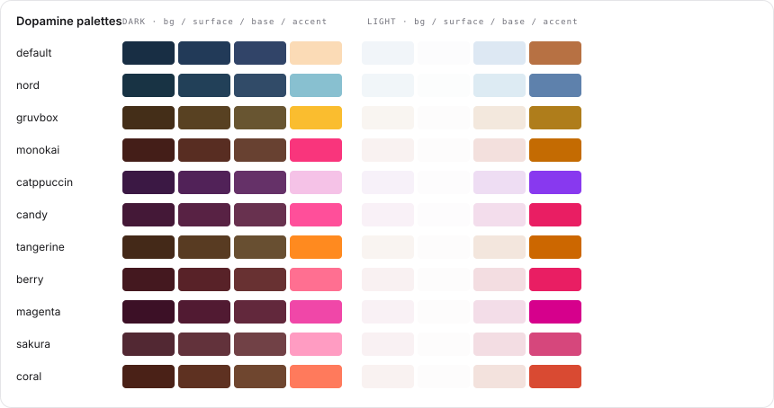

每一行是一个配色（含兜底的 `default`）：左侧 4 格为 Dark 的 `background / surface / base / accent`，右侧 4 格为 Light 的同名色。色块是色板原值，缩放不糊。

| 配色 | 风格 | Dark 强调 | Dark 背景 / 内容区 | Light 强调 | Light 背景 / 内容区 |
|---|---|---|---|---|---|
| `nord` | 冰蓝 / 北极 | `#88C0D0` | `#183344` / `#314B68` | `#5E81AC` | `#F1F6F9` / `#DDEBF3` |
| `gruvbox` | 暖金 / 大地 | `#FABD2F` | `#442E18` / `#685531` | `#AF7D1B` | `#F9F5F1` / `#F3E8DD` |
| `monokai` | 暖黑 / 霓虹 | `#F9357C` | `#441E18` / `#684131` | `#C46B02` | `#F9F2F1` / `#F3E0DD` |
| `catppuccin` | 紫粉 / pastel | `#F5C2E7` | `#3B1844` / `#653168` | `#8839EF` | `#F7F1F9` / `#EEDDF3` |
| `candy` | 糖果粉 | `#FF4F9A` | `#441837` / `#68314F` | `#E91E63` | `#F9F1F7` / `#F3DDEC` |
| `tangerine` | 活力橙 | `#FF8A1F` | `#442918` / `#684F31` | `#CC6700` | `#F9F4F1` / `#F3E6DD` |
| `berry` | 酒红 / 浆果 | `#FF6F91` | `#44181F` / `#683132` | `#E91E63` | `#F9F1F2` / `#F3DDE1` |
| `magenta` | 品红 / 霓虹 | `#F047A8` | `#3C1026` / `#62283C` | `#D6008C` | `#F9F1F5` / `#F3DDE8` |
| `sakura` | 樱花粉 | `#FF9CC2` | `#522833` / `#714146` | `#D6477C` | `#F9F1F3` / `#F3DDE3` |
| `coral` | 珊瑚 / 陶土 | `#FF7A5C` | `#4A2117` / `#6F462F` | `#D94A32` | `#F9F2F1` / `#F3E2DD` |

> 未指定 `-t` 时使用兜底配色 `default`，见文末「默认配色」。

## 配色卡

每张卡片列出该配色的 8 个核心角色（background / surface / base / base-alt / accent / text / link / error）及色值；
底部色条表示 `surface · base · accent` 在窗口中的大致面积占比——这也是「为什么强调色只占小面积」的直观说明。

点击展开：

<details>
<summary><b>nord</b> · 冰蓝 / 北极</summary>

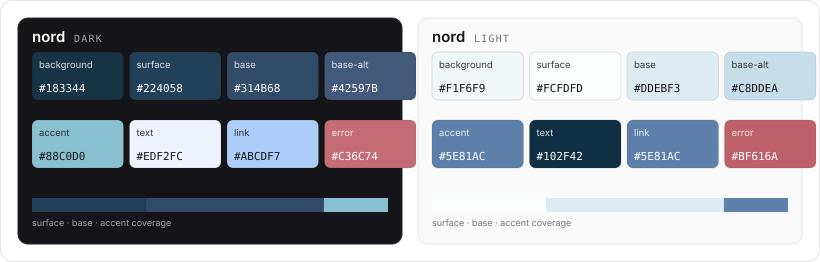

`dark` 背景 `#183344`（203° / 48% / 18%）· 内容区 `#314B68` · 强调 `#88C0D0`　　`light` 背景 `#F1F6F9` · 内容区 `#DDEBF3` · 强调 `#5E81AC`

</details>

<details>
<summary><b>gruvbox</b> · 暖金 / 大地</summary>

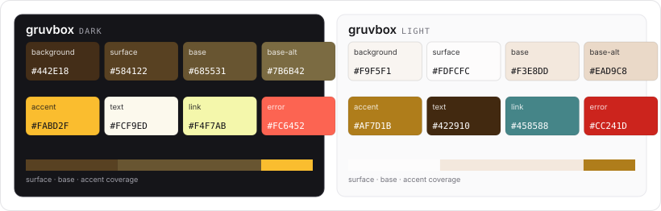

`dark` 背景 `#442E18`（30° / 48% / 18%）· 内容区 `#685531` · 强调 `#FABD2F`　　`light` 背景 `#F9F5F1` · 内容区 `#F3E8DD` · 强调 `#AF7D1B`

</details>

<details>
<summary><b>monokai</b> · 暖黑 / 霓虹</summary>

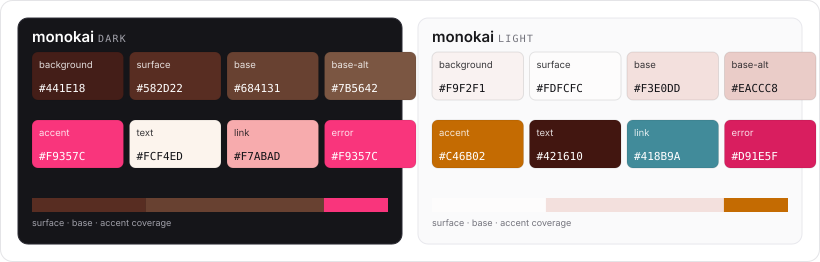

`dark` 背景 `#441E18`（8° / 48% / 18%）· 内容区 `#684131` · 强调 `#F9357C`　　`light` 背景 `#F9F2F1` · 内容区 `#F3E0DD` · 强调 `#C46B02`

</details>

<details>
<summary><b>catppuccin</b> · 紫粉 / pastel</summary>

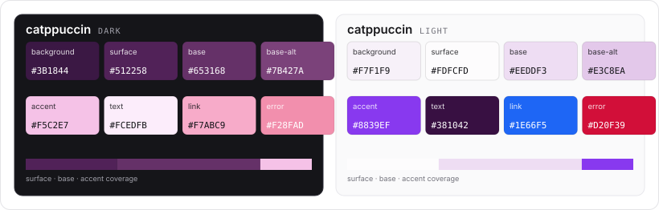

`dark` 背景 `#3B1844`（288° / 48% / 18%）· 内容区 `#653168` · 强调 `#F5C2E7`　　`light` 背景 `#F7F1F9` · 内容区 `#EEDDF3` · 强调 `#8839EF`

</details>

<details>
<summary><b>candy</b> · 糖果粉</summary>

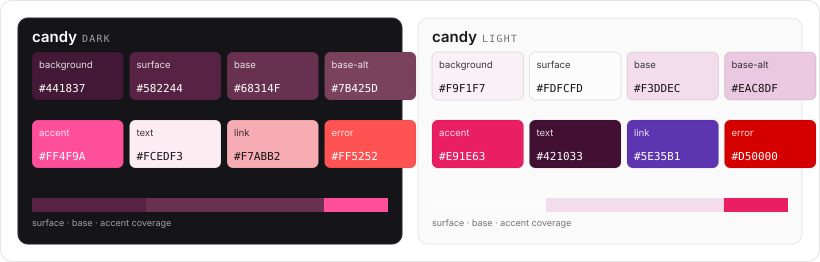

`dark` 背景 `#441837`（318° / 48% / 18%）· 内容区 `#68314F` · 强调 `#FF4F9A`　　`light` 背景 `#F9F1F7` · 内容区 `#F3DDEC` · 强调 `#E91E63`

</details>

<details>
<summary><b>tangerine</b> · 活力橙</summary>

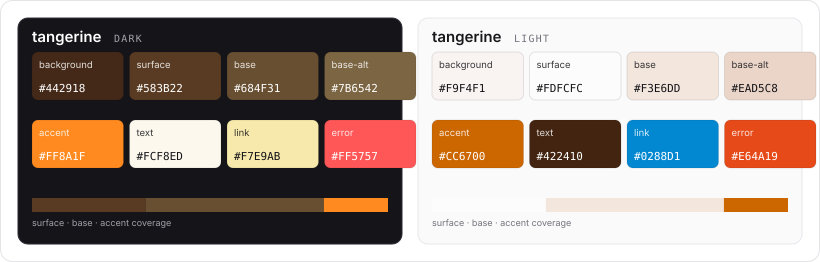

`dark` 背景 `#442918`（23° / 48% / 18%）· 内容区 `#684F31` · 强调 `#FF8A1F`　　`light` 背景 `#F9F4F1` · 内容区 `#F3E6DD` · 强调 `#CC6700`

</details>

<details>
<summary><b>berry</b> · 酒红 / 浆果</summary>

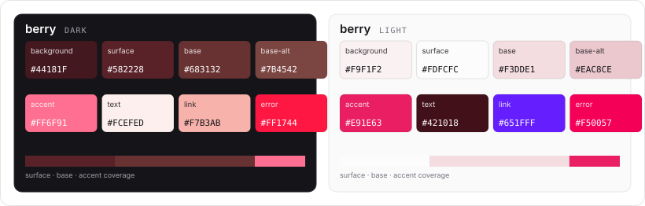

`dark` 背景 `#44181F`（350° / 48% / 18%）· 内容区 `#683132` · 强调 `#FF6F91`　　`light` 背景 `#F9F1F2` · 内容区 `#F3DDE1` · 强调 `#E91E63`

</details>

<details>
<summary><b>magenta</b> · 品红 / 霓虹</summary>

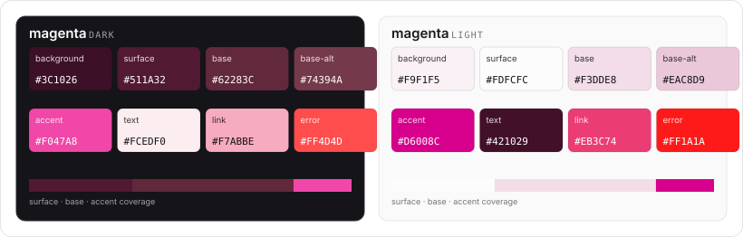

`dark` 背景 `#3C1026`（330° / 58% / 15%）· 内容区 `#62283C` · 强调 `#F047A8`　　`light` 背景 `#F9F1F5` · 内容区 `#F3DDE8` · 强调 `#D6008C`

</details>

<details>
<summary><b>sakura</b> · 樱花粉</summary>

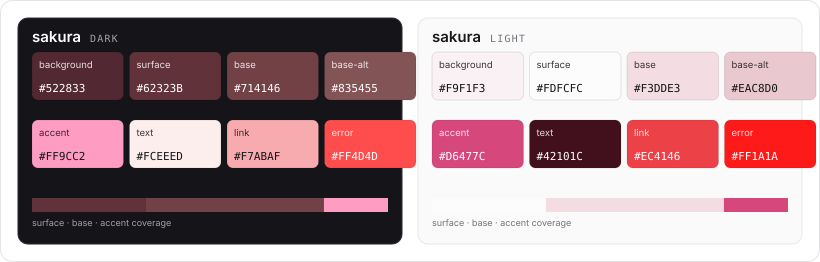

`dark` 背景 `#522833`（344° / 34% / 24%）· 内容区 `#714146` · 强调 `#FF9CC2`　　`light` 背景 `#F9F1F3` · 内容区 `#F3DDE3` · 强调 `#D6477C`

</details>

<details>
<summary><b>coral</b> · 珊瑚 / 陶土</summary>

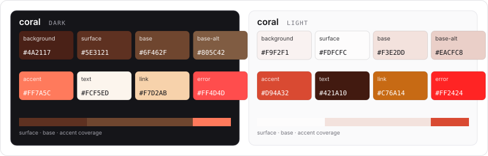

`dark` 背景 `#4A2117`（12° / 53% / 19%）· 内容区 `#6F462F` · 强调 `#FF7A5C`　　`light` 背景 `#F9F2F1` · 内容区 `#F3E2DD` · 强调 `#D94A32`

</details>

## 默认配色

`default` 是不带 `-t` 参数时安装的兜底配色，与上面的 10 套独立：

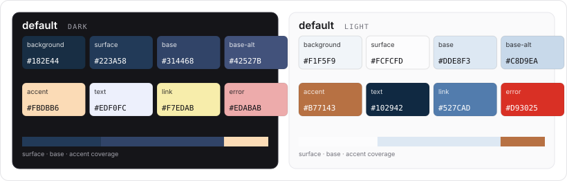

## 界面示意

下面是按色板渲染的窗口示意图（**不是截屏**）——标题栏 / 侧栏 / 内容区 / 选中行 / 开关 / 进度条：

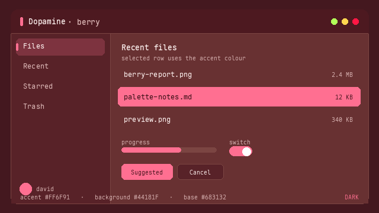


全部配色的示意图与两张总览：

- `assets/preview/<配色>-<dark|light>.png`（20 张）
- `assets/preview/contact-sheet-dark.png` / `contact-sheet-light.png`

## 依赖

- GTK `>= 3.20`
- `gnome-themes-extra`（或 `gnome-themes-standard`）
- Murrine 引擎（GTK 2 需要），包名因发行版而异：
  - Arch Linux：`gtk-engine-murrine`
  - Fedora：`gtk-murrine-engine`
  - openSUSE：`gtk2-engine-murrine`
  - Debian / Ubuntu：`gtk2-engines-murrine`
- `sassc`：编译依赖，`install.sh` 会自动调用
- 重新生成资源/预览时需要 `python3` + `Pillow` + `numpy`

## 安装

```sh
./build.sh       # 编译 CSS、重着色资源、刷新预览
./install.sh     # 安装（默认 default 配色的 Dark + Light）
```

常用示例：

```sh
./install.sh -t all                # 全部配色 × Dark/Light
./install.sh -t magenta -c dark    # 只装 magenta 深色
./install.sh -n Dopamine -t sakura # 自定义主题名
```

> 完整选项见 `./install.sh --help`：

```text
-d, --dest DIR          安装目标目录（默认 ~/.themes）
-n, --name NAME         主题名（默认 Dopamine）
-t, --theme VARIANT     配色 [nord|gruvbox|monokai|catppuccin|candy|tangerine|berry|magenta|sakura|coral|all]（默认 default）
-c, --color VARIANT     变体 [light|dark]（默认全部）
-i, --icon VARIANT      面板图标 [default|apple|simple|gnome|ubuntu|arch|manjaro|fedora|debian|void|opensuse|popos|mxlinux|zorin|endeavouros|tux|nixos]（默认 default）
-l, --libadwaita        链接 gtk4 配置以作用于 libadwaita
-u, --uninstall         卸载主题
--tweaks                [solid|float|round|noborder|square]
-h, --help              显示帮助
```

安装后的主题目录命名为 `Dopamine[-配色]-Light|-Dark`，例如 `~/.themes/Dopamine-magenta-Dark`。

## 验证安装后的色值

```sh
grep -m3 '@define-color theme_.*_color' ~/.themes/Dopamine-berry-Dark/gtk-3.0/gtk.css
# @define-color theme_bg_color #44181F
# @define-color theme_base_color #683132
# @define-color theme_selected_bg_color #FF6F91
```

## GNOME 下让 GTK 3 / GTK 4 / libadwaita 应用生效

部分 GTK 应用不跟随 GNOME Tweaks 的主题设置。每个安装好的主题目录里都有 `gtk-set.sh`，运行它会把当前主题链接到
`~/.config/gtk-3.0` 和 `~/.config/gtk-4.0`：

```sh
~/.themes/Dopamine-magenta-Dark/gtk-set.sh
```

脚本会自动创建/清理配置目录、移除旧符号链接、备份同名文件（`*.bak.<时间戳>`），并为 `gtk.css`、`gtk-dark.css`、`assets`
建立符号链接。等价手动命令：

```sh
theme="$HOME/.themes/Dopamine-magenta-Dark"

mkdir -p "$HOME/.config/gtk-3.0" "$HOME/.config/gtk-4.0"

ln -sfn "$theme/gtk-3.0/gtk.css"      "$HOME/.config/gtk-3.0/gtk.css"
ln -sfn "$theme/gtk-3.0/gtk-dark.css" "$HOME/.config/gtk-3.0/gtk-dark.css"
ln -sfn "$theme/gtk-3.0/assets"       "$HOME/.config/gtk-3.0/assets"

ln -sfn "$theme/gtk-4.0/gtk.css"      "$HOME/.config/gtk-4.0/gtk.css"
ln -sfn "$theme/gtk-4.0/gtk-dark.css" "$HOME/.config/gtk-4.0/gtk-dark.css"
ln -sfn "$theme/gtk-4.0/assets"       "$HOME/.config/gtk-4.0/assets"
```

> libadwaita 应用（文件管理器、设置等）还会读取 GNOME 的系统强调色。若要让强调色与主题一致，请一并设置：
> `gsettings set org.gnome.desktop.interface accent-color 'pink'`

## dash-to-panel 适配

本主题针对 Dash to Panel 做了几何适配：dtp 接管面板时会重写面板的尺寸分配，主题检测到 `.dashtopanelMainPanel` 类后会自动关闭悬浮面板的 margin 和圆角（见 `src/gnome-shell/sass/widgets/_panel.scss`），避免任务栏内容被压出面板背景之外。

使用 dtp 时如需进一步调整任务栏外观，可参考 `src/gnome-shell/extensions/dash-to-panel/stylesheet.css`。

## Firefox 主题

`src/firefox` 目录提供 Firefox 主题资源，安装方法见该目录下的 README。

## 构建

本仓库只保留源码，不提交编译产物。克隆后、安装前请先运行：

```sh
./build.sh
```

它依次执行：

1. `./parse-sass.sh` —— 编译所有 GTK / GNOME Shell / Cinnamon 的 `.css`
2. `python3 scripts/generate-theme-assets.py` —— 按色板重着色 GTK2/3 PNG、Shell SVG、gtkrc、thumbnail
3. `python3 scripts/gen-previews.py --contact-sheet` —— 生成窗口示意 PNG 与两张总览
4. `python3 scripts/gen-palette-cards.py` —— 生成 `assets/preview/overview.svg` 与 `palettes/*.svg`

只改了配色（`src/_sass/_theme-palettes.scss`）时，跑完这四步即可让 CSS、资源、README 图全部同步。

## 配色设计

调色板定义在 `src/_sass/_theme-palettes.scss`，GTK 与 GNOME Shell 共用同一份 map。每个配色包含 dark/light 两套完整角色：
背景、表面、内容区、次级表面、正文、次级文字、强调、链接、语义色、标题栏/面板。

- **Dark**：同色相阶梯，明度 15%–37%、饱和 22%–58%，色相逐级 +4°/+9°/+13° 偏暖——深，但颜色浓郁、不发灰。
- **Light**：同色相浅底（背景 S≈42/L≈96，内容区 S≈46/L≈91），不再用冷白/纯白。
- **强调色**保留各配色的参考色相，仅在对比不足时自动微调：dark 对内容区 ≥2.4:1，light ≥3.0:1，次级文字 ≥4.5:1。

三套新暖色的参考来源：

| 配色 | 参考 | 说明 |
|---|---|---|
| magenta | Rosé Pine [`love #EB6F92`](https://rosepinetheme.com/palette)、Catppuccin [`pink #F5C2E7`](https://github.com/catppuccin/catppuccin) | 最暗最艳（L15/S58），霓虹品红 |
| sakura | Kanagawa [`sakuraPink #D27E99`](https://github.com/rebelot/kanagawa.nvim)、Catppuccin `rosewater #F5E0DC` | 最浅最柔（L24/S34），奶油樱花 |
| coral | Kanagawa [`peachRed #FF5D62`](https://github.com/rebelot/kanagawa.nvim)、[Sweet Twilight](https://colordrop.io/palette/35154) `#D46A3B` | 居中（L19/S52），陶土珊瑚 |

新增/修改配色的流程、历史决策与踩坑见 [CUSTOMIZATION.md](CUSTOMIZATION.md)；配色与预览一致性的排查记录见 [INVESTIGATION-color-mismatch.md](INVESTIGATION-color-mismatch.md)。

## 卸载

```sh
./install.sh -u -t berry     # 卸载指定配色
./install.sh -u -t all       # 卸载全部
```

## License

本仓库整体以 [GNU General Public License v3.0](COPYING) 发布。

这是一个 fork 自 [vinceliuice/Fluent-gtk-theme](https://github.com/vinceliuice/Fluent-gtk-theme) 的派生项目，在 Fluent 主题的基础上重新设计了配色系统、新增了暖色配色，并做了 GNOME Shell 48/50 等现代版本的适配。

### 第三方资源与致谢

- **GTK / GNOME Shell / Cinnamon / Metacity / xfwm4 / labwc / plank 主题框架**：源自 [vinceliuice/Fluent-gtk-theme](https://github.com/vinceliuice/Fluent-gtk-theme)，GPL v3。
- **部分 SVG 资源**：来自 GNOME 官方主题资源，原文件内部声明使用 [CC BY-SA 4.0](https://creativecommons.org/licenses/by-sa/4.0/)。本仓库随 Fluent 主题继承使用这些资源，并在发布时继续遵循其授权要求。
- **Firefox 主题**（`src/firefox/`）：基于 [rafaelmardojai/firefox-gnome-theme](https://github.com/rafaelmardojai/firefox-gnome-theme) 及其上游作品，原项目使用 [The Unlicense](https://unlicense.org/)（公共领域 dedication），详见 `src/firefox/LICENSE` 与 `src/firefox/README.md` 的 Credits 章节。
- **配色参考**：Rosé Pine、Kanagawa、Catppuccin、ColorDrop 等开源配色方案，色值仅作色相与明度参考，未直接复制其主题文件。

如果你是律师或相关权利人，发现本仓库在授权声明上有遗漏或错误，欢迎开 issue 指正。
